# Poly Haven: Fields & Countryside HDRIs

**111 assets from [Poly Haven](https://polyhaven.com), dedicated to the public domain under [CC0](https://polyhaven.com/license).** Use them in any game, free or paid, and change them however you like; no credit is needed.

HDRI skies and environments as 1K and 2K Radiance `.hdr` images, for lighting and backgrounds. 887.8 MB in all.

This is a copy kept by [zuujis-cc0](https://github.com/zuujis-cc0) so game makers can take single files from GitHub. It is not made by or affiliated with Poly Haven: the originals, in more formats and higher resolutions, are on [polyhaven.com](https://polyhaven.com). If they help you, consider [supporting Poly Haven](https://www.patreon.com/polyhaven/overview).

Every file is listed in [MANIFEST.tsv](MANIFEST.tsv) with its size and SHA-256. More free assets: [the collection](https://github.com/zuujis-cc0/free-game-assets#readme).

| | | | |
| :-: | :-: | :-: | :-: |
| <a href="abandoned_pathway">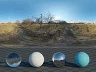</a> <b><a href="abandoned_pathway">Abandoned Pathway</a></b> by Sergej Majboroda · <a href="https://polyhaven.com/a/abandoned_pathway">source</a> | <a href="abandoned_tank_farm_04">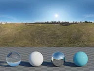</a> <b><a href="abandoned_tank_farm_04">Abandoned Tank Farm 04</a></b> by Sergej Majboroda · <a href="https://polyhaven.com/a/abandoned_tank_farm_04">source</a> | <a href="aloe_farm_shade_house">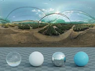</a> <b><a href="aloe_farm_shade_house">Aloe Farm Shade House</a></b> by Dimitrios Savva, Jarod Guest · <a href="https://polyhaven.com/a/aloe_farm_shade_house">source</a> | <a href="autumn_field">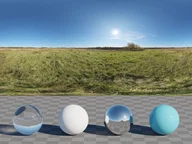</a> <b><a href="autumn_field">Autumn Field</a></b> by Sergej Majboroda · <a href="https://polyhaven.com/a/autumn_field">source</a> |
| <a href="autumn_hilly_field">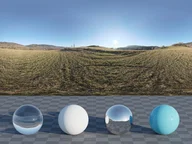</a> <b><a href="autumn_hilly_field">Autumn Hilly Field</a></b> by Grzegorz Wronkowski · <a href="https://polyhaven.com/a/autumn_hilly_field">source</a> | <a href="autumn_meadow">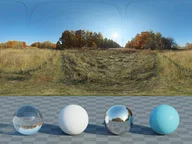</a> <b><a href="autumn_meadow">Autumn Meadow</a></b> by Sergej Majboroda · <a href="https://polyhaven.com/a/autumn_meadow">source</a> | <a href="bambanani_sunset">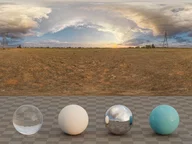</a> <b><a href="bambanani_sunset">Bambanani Sunset</a></b> by Dimitrios Savva, Jarod Guest · <a href="https://polyhaven.com/a/bambanani_sunset">source</a> | <a href="belfast_farmhouse">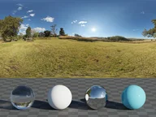</a> <b><a href="belfast_farmhouse">Belfast Farmhouse</a></b> by Dimitrios Savva, Jarod Guest · <a href="https://polyhaven.com/a/belfast_farmhouse">source</a> |
| <a href="belfast_open_field">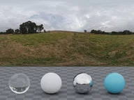</a> <b><a href="belfast_open_field">Belfast Open Field</a></b> by Dimitrios Savva, Jarod Guest · <a href="https://polyhaven.com/a/belfast_open_field">source</a> | <a href="bloem_field_sunrise">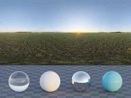</a> <b><a href="bloem_field_sunrise">Bloem Field Sunrise</a></b> by Greg Zaal, Jenelle van Heerden · <a href="https://polyhaven.com/a/bloem_field_sunrise">source</a> | <a href="bloem_train_track_clear">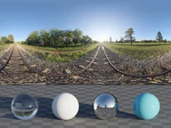</a> <b><a href="bloem_train_track_clear">Bloem Train Track Clear</a></b> by Greg Zaal, Jenelle van Heerden · <a href="https://polyhaven.com/a/bloem_train_track_clear">source</a> | <a href="bloem_train_track_cloudy">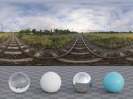</a> <b><a href="bloem_train_track_cloudy">Bloem Train Track Cloudy</a></b> by Greg Zaal, Jenelle van Heerden · <a href="https://polyhaven.com/a/bloem_train_track_cloudy">source</a> |
| <a href="citrus_orchard">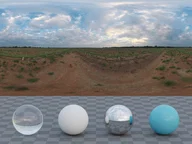</a> <b><a href="citrus_orchard">Citrus Orchard</a></b> by Dimitrios Savva, Jarod Guest · <a href="https://polyhaven.com/a/citrus_orchard">source</a> | <a href="citrus_orchard_road">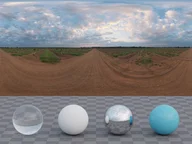</a> <b><a href="citrus_orchard_road">Citrus Orchard Road</a></b> by Dimitrios Savva, Jarod Guest · <a href="https://polyhaven.com/a/citrus_orchard_road">source</a> | <a href="cloud_layers">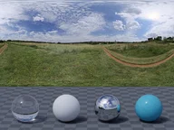</a> <b><a href="cloud_layers">Cloud Layers</a></b> by Greg Zaal · <a href="https://polyhaven.com/a/cloud_layers">source</a> | <a href="cloudy_netted_nursery">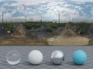</a> <b><a href="cloudy_netted_nursery">Cloudy Netted Nursery</a></b> by Dimitrios Savva, Jarod Guest · <a href="https://polyhaven.com/a/cloudy_netted_nursery">source</a> |
| <a href="countrytrax_midday">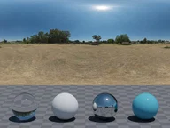</a> <b><a href="countrytrax_midday">Countrytrax Midday</a></b> by Dimitrios Savva, Jarod Guest · <a href="https://polyhaven.com/a/countrytrax_midday">source</a> | <a href="dam_road">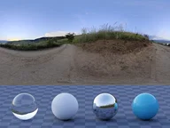</a> <b><a href="dam_road">Dam Road</a></b> by Greg Zaal · <a href="https://polyhaven.com/a/dam_road">source</a> | <a href="dikhololo_night">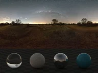</a> <b><a href="dikhololo_night">Dikhololo Night</a></b> by Greg Zaal · <a href="https://polyhaven.com/a/dikhololo_night">source</a> | <a href="dikhololo_sunset">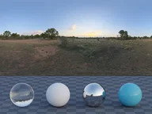</a> <b><a href="dikhololo_sunset">Dikhololo Sunset</a></b> by Greg Zaal · <a href="https://polyhaven.com/a/dikhololo_sunset">source</a> |
| <a href="dreifaltigkeitsberg">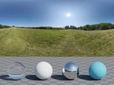</a> <b><a href="dreifaltigkeitsberg">Dreifaltigkeitsberg</a></b> by Andreas Mischok · <a href="https://polyhaven.com/a/dreifaltigkeitsberg">source</a> | <a href="dry_field">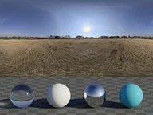</a> <b><a href="dry_field">Dry Field</a></b> by Greg Zaal · <a href="https://polyhaven.com/a/dry_field">source</a> | <a href="dry_hay_field">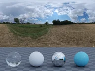</a> <b><a href="dry_hay_field">Dry Hay Field</a></b> by Alexander Scholten · <a href="https://polyhaven.com/a/dry_hay_field">source</a> | <a href="dry_meadow">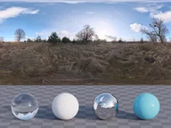</a> <b><a href="dry_meadow">Dry Meadow</a></b> by Greg Zaal, Sergej Majboroda · <a href="https://polyhaven.com/a/dry_meadow">source</a> |
| <a href="dry_orchard_meadow">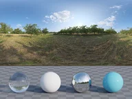</a> <b><a href="dry_orchard_meadow">Dry Orchard Meadow</a></b> by Alexander Scholten · <a href="https://polyhaven.com/a/dry_orchard_meadow">source</a> | <a href="etzwihl">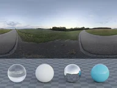</a> <b><a href="etzwihl">Etzwihl</a></b> by Adrian Kubasa · <a href="https://polyhaven.com/a/etzwihl">source</a> | <a href="evening_field">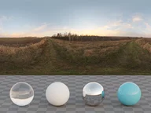</a> <b><a href="evening_field">Evening Field</a></b> by Sergej Majboroda · <a href="https://polyhaven.com/a/evening_field">source</a> | <a href="evening_meadow">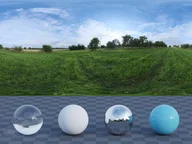</a> <b><a href="evening_meadow">Evening Meadow</a></b> by Alexander Scholten · <a href="https://polyhaven.com/a/evening_meadow">source</a> |
| <a href="evening_road_01">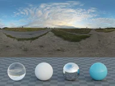</a> <b><a href="evening_road_01">Evening Road 01</a></b> by Sergej Majboroda · <a href="https://polyhaven.com/a/evening_road_01">source</a> | <a href="farm_field">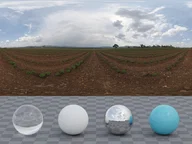</a> <b><a href="farm_field">Farm Field</a></b> by Dimitrios Savva, Jarod Guest · <a href="https://polyhaven.com/a/farm_field">source</a> | <a href="farm_road">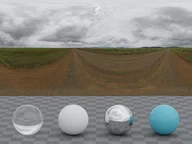</a> <b><a href="farm_road">Farm Road</a></b> by Dario Barresi · <a href="https://polyhaven.com/a/farm_road">source</a> | <a href="farm_sunset">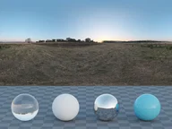</a> <b><a href="farm_sunset">Farm Sunset</a></b> by Dimitrios Savva, Jarod Guest · <a href="https://polyhaven.com/a/farm_sunset">source</a> |
| <a href="farmland_overcast">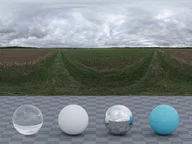</a> <b><a href="farmland_overcast">Farmland Overcast</a></b> by Grzegorz Wronkowski · <a href="https://polyhaven.com/a/farmland_overcast">source</a> | <a href="flower_road">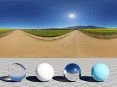</a> <b><a href="flower_road">Flower Road</a></b> by Greg Zaal · <a href="https://polyhaven.com/a/flower_road">source</a> | <a href="geislingen_an_der_steige">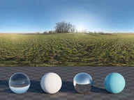</a> <b><a href="geislingen_an_der_steige">Geislingen An Der Steige</a></b> by Andreas Mischok · <a href="https://polyhaven.com/a/geislingen_an_der_steige">source</a> | <a href="golf_course_sunrise">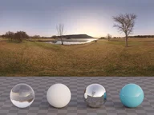</a> <b><a href="golf_course_sunrise">Golf Course Sunrise</a></b> by Dimitrios Savva, Jarod Guest · <a href="https://polyhaven.com/a/golf_course_sunrise">source</a> |
| <a href="grasslands_sunset">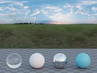</a> <b><a href="grasslands_sunset">Grasslands Sunset</a></b> by Dimitrios Savva, Jarod Guest · <a href="https://polyhaven.com/a/grasslands_sunset">source</a> | <a href="harvest">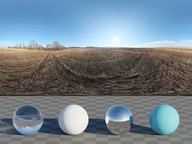</a> <b><a href="harvest">Harvest</a></b> by Greg Zaal, Sergej Majboroda · <a href="https://polyhaven.com/a/harvest">source</a> | <a href="hausdorf_clear_sky">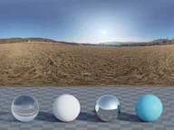</a> <b><a href="hausdorf_clear_sky">Hausdorf Clear Sky</a></b> by Grzegorz Wronkowski · <a href="https://polyhaven.com/a/hausdorf_clear_sky">source</a> | <a href="hausdorf_meadow">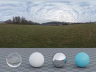</a> <b><a href="hausdorf_meadow">Hausdorf Meadow</a></b> by Grzegorz Wronkowski · <a href="https://polyhaven.com/a/hausdorf_meadow">source</a> |
| <a href="hay_bales">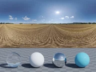</a> <b><a href="hay_bales">Hay Bales</a></b> by Grzegorz Wronkowski · <a href="https://polyhaven.com/a/hay_bales">source</a> | <a href="hochsal_field">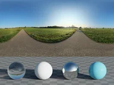</a> <b><a href="hochsal_field">Hochsal Field</a></b> by Adrian Kubasa · <a href="https://polyhaven.com/a/hochsal_field">source</a> | <a href="horn-koppe_snow">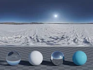</a> <b><a href="horn-koppe_snow">Horn-koppe Snow</a></b> by Grzegorz Wronkowski · <a href="https://polyhaven.com/a/horn-koppe_snow">source</a> | <a href="horn-koppe_spring">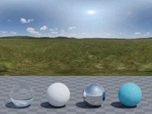</a> <b><a href="horn-koppe_spring">Horn-koppe Spring</a></b> by Grzegorz Wronkowski · <a href="https://polyhaven.com/a/horn-koppe_spring">source</a> |
| <a href="industrial_sunset">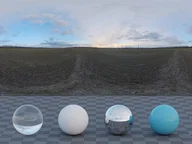</a> <b><a href="industrial_sunset">Industrial Sunset</a></b> by Sergej Majboroda · <a href="https://polyhaven.com/a/industrial_sunset">source</a> | <a href="industrial_sunset_02">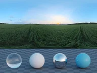</a> <b><a href="industrial_sunset_02">Industrial Sunset 02</a></b> by Sergej Majboroda · <a href="https://polyhaven.com/a/industrial_sunset_02">source</a> | <a href="kloppenheim_01">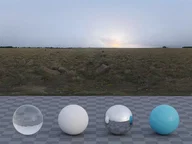</a> <b><a href="kloppenheim_01">Kloppenheim 01</a></b> by Greg Zaal · <a href="https://polyhaven.com/a/kloppenheim_01">source</a> | <a href="kloppenheim_02">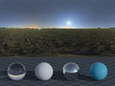</a> <b><a href="kloppenheim_02">Kloppenheim 02</a></b> by Greg Zaal · <a href="https://polyhaven.com/a/kloppenheim_02">source</a> |
| <a href="kloppenheim_03">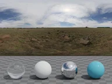</a> <b><a href="kloppenheim_03">Kloppenheim 03</a></b> by Greg Zaal · <a href="https://polyhaven.com/a/kloppenheim_03">source</a> | <a href="kloppenheim_04">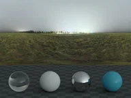</a> <b><a href="kloppenheim_04">Kloppenheim 04</a></b> by Greg Zaal · <a href="https://polyhaven.com/a/kloppenheim_04">source</a> |  <b><a href="kloppenheim_05">Kloppenheim 05</a></b> by Greg Zaal · <a href="https://polyhaven.com/a/kloppenheim_05">source</a> |  <b><a href="kloppenheim_07">Kloppenheim 07</a></b> by Greg Zaal · <a href="https://polyhaven.com/a/kloppenheim_07">source</a> |
|  <b><a href="lilienstein">Lilienstein</a></b> by Andreas Mischok · <a href="https://polyhaven.com/a/lilienstein">source</a> |  <b><a href="lonely_road_afternoon">Lonely Road Afternoon</a></b> by Dimitrios Savva, Jarod Guest · <a href="https://polyhaven.com/a/lonely_road_afternoon">source</a> |  <b><a href="lot_01">Lot 01</a></b> by Philip Modin · <a href="https://polyhaven.com/a/lot_01">source</a> |  <b><a href="ludwikowice_farmland">Ludwikowice Farmland</a></b> by Grzegorz Wronkowski · <a href="https://polyhaven.com/a/ludwikowice_farmland">source</a> |
|  <b><a href="lythwood_field">Lythwood Field</a></b> by Greg Zaal · <a href="https://polyhaven.com/a/lythwood_field">source</a> |  <b><a href="magalies_field_sunset">Magalies Field Sunset</a></b> by Dimitrios Savva, Jarod Guest · <a href="https://polyhaven.com/a/magalies_field_sunset">source</a> |  <b><a href="malagas_ferry_road">Malagas Ferry Road</a></b> by Jenelle van Heerden · <a href="https://polyhaven.com/a/malagas_ferry_road">source</a> |  <b><a href="mealie_road">Mealie Road</a></b> by Greg Zaal · <a href="https://polyhaven.com/a/mealie_road">source</a> |
|  <b><a href="misty_dawn">Misty Dawn</a></b> by Greg Zaal · <a href="https://polyhaven.com/a/misty_dawn">source</a> |  <b><a href="misty_farm_road">Misty Farm Road</a></b> by Alexander Scholten · <a href="https://polyhaven.com/a/misty_farm_road">source</a> |  <b><a href="moonless_golf">Moonless Golf</a></b> by Greg Zaal · <a href="https://polyhaven.com/a/moonless_golf">source</a> |  <b><a href="moonlit_golf">Moonlit Golf</a></b> by Greg Zaal · <a href="https://polyhaven.com/a/moonlit_golf">source</a> |
|  <b><a href="mpumalanga_veld">Mpumalanga Veld</a></b> by Greg Zaal · <a href="https://polyhaven.com/a/mpumalanga_veld">source</a> |  <b><a href="mud_road">Mud Road</a></b> by Sergey Rudavin · <a href="https://polyhaven.com/a/mud_road">source</a> |  <b><a href="noon_grass">Noon Grass</a></b> by Greg Zaal · <a href="https://polyhaven.com/a/noon_grass">source</a> |  <b><a href="oberer_kuhberg">Oberer Kuhberg</a></b> by Andreas Mischok · <a href="https://polyhaven.com/a/oberer_kuhberg">source</a> |
|  <b><a href="outdoor_workshop">Outdoor Workshop</a></b> by Dimitrios Savva, Jarod Guest · <a href="https://polyhaven.com/a/outdoor_workshop">source</a> |  <b><a href="overcast_soil">Overcast Soil</a></b> by Sergej Majboroda · <a href="https://polyhaven.com/a/overcast_soil">source</a> |  <b><a href="overcast_soil_2">Overcast Soil 2</a></b> by Sergej Majboroda · <a href="https://polyhaven.com/a/overcast_soil_2">source</a> |  <b><a href="partial_eclipse">Partial Eclipse</a></b> by Greg Zaal · <a href="https://polyhaven.com/a/partial_eclipse">source</a> |
|  <b><a href="passendorf_snow">Passendorf Snow</a></b> by Grzegorz Wronkowski · <a href="https://polyhaven.com/a/passendorf_snow">source</a> |  <b><a href="pisztyk">Pisztyk</a></b> by Grzegorz Wronkowski · <a href="https://polyhaven.com/a/pisztyk">source</a> |  <b><a href="plains_sunset">Plains Sunset</a></b> by Dimitrios Savva, Jarod Guest · <a href="https://polyhaven.com/a/plains_sunset">source</a> |  <b><a href="preller_drive">Preller Drive</a></b> by Greg Zaal · <a href="https://polyhaven.com/a/preller_drive">source</a> |
|  <b><a href="railway_bridge_02">Railway Bridge 02</a></b> by Sergej Majboroda · <a href="https://polyhaven.com/a/railway_bridge_02">source</a> |  <b><a href="reichstag_1">Reichstag 1</a></b> by Greg Zaal · <a href="https://polyhaven.com/a/reichstag_1">source</a> |  <b><a href="rosendal_plains_1">Rosendal Plains 1</a></b> by Dimitrios Savva, Jarod Guest · <a href="https://polyhaven.com/a/rosendal_plains_1">source</a> |  <b><a href="rosendal_plains_2">Rosendal Plains 2</a></b> by Dimitrios Savva, Jarod Guest · <a href="https://polyhaven.com/a/rosendal_plains_2">source</a> |
|  <b><a href="rural_asphalt_road">Rural Asphalt Road</a></b> by Alexander Scholten · <a href="https://polyhaven.com/a/rural_asphalt_road">source</a> |  <b><a href="rural_crossroads">Rural Crossroads</a></b> by Sergej Majboroda · <a href="https://polyhaven.com/a/rural_crossroads">source</a> |  <b><a href="rural_evening_road">Rural Evening Road</a></b> by Alexander Scholten · <a href="https://polyhaven.com/a/rural_evening_road">source</a> |  <b><a href="rural_graffiti_tower">Rural Graffiti Tower</a></b> by Andreas Mischok · <a href="https://polyhaven.com/a/rural_graffiti_tower">source</a> |
|  <b><a href="rural_winter_roadside">Rural Winter Roadside</a></b> by Sergej Majboroda · <a href="https://polyhaven.com/a/rural_winter_roadside">source</a> |  <b><a href="safari_sunset">Safari Sunset</a></b> by Dimitrios Savva, Jarod Guest · <a href="https://polyhaven.com/a/safari_sunset">source</a> |  <b><a href="satara_night">Satara Night</a></b> by Greg Zaal · <a href="https://polyhaven.com/a/satara_night">source</a> |  <b><a href="satara_night_no_lamps">Satara Night (No Lamps)</a></b> by Greg Zaal · <a href="https://polyhaven.com/a/satara_night_no_lamps">source</a> |
|  <b><a href="scythian_tombs">Scythian Tombs</a></b> by Sergej Majboroda · <a href="https://polyhaven.com/a/scythian_tombs">source</a> |  <b><a href="scythian_tombs_2">Scythian Tombs 2</a></b> by Sergej Majboroda · <a href="https://polyhaven.com/a/scythian_tombs_2">source</a> |  <b><a href="small_rural_road_02">Small Rural Road 02</a></b> by Sergej Majboroda · <a href="https://polyhaven.com/a/small_rural_road_02">source</a> |  <b><a href="snow_field">Snow Field</a></b> by Sergej Majboroda · <a href="https://polyhaven.com/a/snow_field">source</a> |
|  <b><a href="snow_field_2">Snow Field 2</a></b> by Sergej Majboroda · <a href="https://polyhaven.com/a/snow_field_2">source</a> |  <b><a href="snowy_field">Snowy Field</a></b> by Andreas Mischok · <a href="https://polyhaven.com/a/snowy_field">source</a> |  <b><a href="soliltude">Soliltude</a></b> by Andreas Mischok · <a href="https://polyhaven.com/a/soliltude">source</a> |  <b><a href="solitude_night">Solitude Night</a></b> by Andreas Mischok · <a href="https://polyhaven.com/a/solitude_night">source</a> |
|  <b><a href="spruit_sunrise">Spruit Sunrise</a></b> by Greg Zaal · <a href="https://polyhaven.com/a/spruit_sunrise">source</a> |  <b><a href="steinbach_field">Steinbach Field</a></b> by Adrian Kubasa · <a href="https://polyhaven.com/a/steinbach_field">source</a> |  <b><a href="stierberg_sunrise">Stierberg Sunrise</a></b> by Grzegorz Wronkowski · <a href="https://polyhaven.com/a/stierberg_sunrise">source</a> |  <b><a href="straw_rolls_field_01">Straw Rolls Field 01</a></b> by Sergej Majboroda · <a href="https://polyhaven.com/a/straw_rolls_field_01">source</a> |
|  <b><a href="suburban_field_01">Suburban Field 01</a></b> by Jacopo Voltolina · <a href="https://polyhaven.com/a/suburban_field_01">source</a> |  <b><a href="suburban_field_02">Suburban Field 02</a></b> by Jacopo Voltolina · <a href="https://polyhaven.com/a/suburban_field_02">source</a> |  <b><a href="sunflowers">Sunflowers</a></b> by Sergej Majboroda · <a href="https://polyhaven.com/a/sunflowers">source</a> |  <b><a href="sunny_country_road">Sunny Country Road</a></b> by Grzegorz Wronkowski · <a href="https://polyhaven.com/a/sunny_country_road">source</a> |
|  <b><a href="sunset_meadow_path">Sunset Meadow Path</a></b> by Elvis Posa · <a href="https://polyhaven.com/a/sunset_meadow_path">source</a> |  <b><a href="veld_fire">Veld Fire</a></b> by Greg Zaal · <a href="https://polyhaven.com/a/veld_fire">source</a> |  <b><a href="wasteland_clouds">Wasteland Clouds</a></b> by Sergej Majboroda · <a href="https://polyhaven.com/a/wasteland_clouds">source</a> |  <b><a href="waterkloof_farm">Waterkloof Farm</a></b> by Jenelle van Heerden · <a href="https://polyhaven.com/a/waterkloof_farm">source</a> |
|  <b><a href="wildflower_field">Wildflower Field</a></b> by Alexander Scholten · <a href="https://polyhaven.com/a/wildflower_field">source</a> |  <b><a href="winter_orchard">Winter Orchard</a></b> by Dimitrios Savva, Jarod Guest · <a href="https://polyhaven.com/a/winter_orchard">source</a> |  <b><a href="yellow_field">Yellow Field</a></b> by Greg Zaal · <a href="https://polyhaven.com/a/yellow_field">source</a> |  |

---

Updated automatically by [cc0-mirror](https://github.com/zuujis-cc0/cc0-mirror). Something wrong? [Open an issue there](https://github.com/zuujis-cc0/cc0-mirror/issues/new) or use the [private report form](https://games.zuujis.com/report).
